# Architecture

The whole project on one map: what it does, how a pull request moves through it,
the technical choices at each step, and when each part was added.

For the animated version, open [the walkthrough](docs/flow/index.html) in a
browser. It uses example data and shortened code excerpts. Next/Previous and
the route stops pause on a complete scene so you can read at your own pace.

**How to read it**

- Start at the top and follow the numbered steps. They run in the order a review runs.
- **Box colour shows the month that part was first added:** blue is July, amber is August, purple is September, green is October 2026. Grey is an outside system or project reference.
- The last line of a box gives the exact dates.
- Solid arrows are the review's path. Dotted arrows are calls to shared services and the failure path.

Accurate as of commit `196f768` (26 Oct 2026). Dates come from the git history.

Step 7's six attempts mean **one initial call plus up to five retries per
reviewer**. The outer waits total at most 225 seconds; API time and the model
client's own retries add to that. `PerDay` in an error disables the outer retry
policy only. A successful five-reviewer run needs five initial chat calls,
with extra calls possible on retry; the Python report needs none.

```mermaid
%%{init: {"flowchart": {"wrappingWidth": 700, "nodeSpacing": 24, "rankSpacing": 34}}}%%
flowchart TD

    WHAT["<b>Autonomous CI/CD PR Review Swarm</b><br/>A GitHub bot that reviews every pull request.<br/>Five AI reviewers read the change at the same time, with related code from the repo as context.<br/>Plain Python then counts the votes: anything short of 5 out of 5 blocks the merge."]

    subgraph TL["Project timeline"]
        direction LR
        T1["<b>July 2026: the foundation</b><br/><b>14 Jul</b> FastAPI webhook, PR diff fetch,<br/>PR comment, LangGraph with 3 agents<br/>and an LLM orchestrator, first README<br/><b>15 Jul</b> AST chunking, Qdrant and Gemini<br/>embeddings (RAG), QA and Product agents<br/>(now 5), BackgroundTasks, text-match<br/>tally, Python version pinned<br/><b>16 Jul</b> README rewrite, local data ignored"]:::jul
        T2["<b>August 2026: hardening</b><br/><b>27 Aug</b> one large commit:<br/>HMAC signature check, one review per<br/>commit, commit status as the real gate,<br/>structured verdicts, Python gate,<br/>self-healing index, safe git clone,<br/>embeddings.py, qdrant_store.py, per-file<br/>retrieval, health route, 31 tests<br/><b>Removed:</b> text-match tally, LLM report"]:::aug
        T3["<b>September 2026: data layer</b><br/><b>25 Sep</b> PostgreSQL audit trail with<br/>5 tables, database.py, models.py,<br/>db_writer.py, Alembic migrations,<br/>analytics.py, test_db_layer.py<br/><b>Removed the same day:</b> rate_limiter.py,<br/>analytics trimmed to 4 endpoints"]:::sep
        T4["<b>October 2026: reliability</b><br/><b>15 Oct</b> one Qdrant collection per repo,<br/>safe retry of a failed review,<br/>local logs untracked<br/><b>22 Oct</b> retry on Gemini 429 limits,<br/>Flash-Lite becomes the default model<br/><b>26 Oct</b> /dashboard, retry on Gemini 5xx<br/><b>Now:</b> 58 offline tests, all passing"]:::oct
        T1 --> T2 --> T3 --> T4
    end

    subgraph GH["Step 1: GitHub"]
        direction LR
        DEV["<b>Developer</b><br/>Opens, pushes to or reopens a PR"]:::ext
        HOOK["<b>GitHub webhook</b><br/>POST /webhook, signed in X-Hub-Signature-256<br/>Delivery is at-least-once, so duplicates can arrive"]:::ext
        DEV --> HOOK
    end

    subgraph GW["Step 2: Gateway, main.py"]
        direction LR
        G1["<b>verify_signature</b><br/>HMAC-SHA256 over raw bytes,<br/>constant-time compare<br/>Bad or missing: 401 when secret is set<br/>Unset secret skips verification<br/><i>Added 27 Aug</i>"]:::aug
        G2["<b>Event filter</b><br/>ping: pong. Others: 200 ignored<br/>Keeps PR actions opened,<br/>synchronize, reopened<br/><i>Added 14 Jul, tightened 27 Aug</i>"]:::jul
        G3["<b>Payload checks</b><br/>Bad JSON or missing fields: 400<br/>Draft PR: 200 ignored<br/><i>Added 27 Aug</i>"]:::aug
        G4["<b>claim_delivery</b><br/>Key: (repo, head_sha)<br/>In-process, last 512 kept<br/>Seen before: 200 duplicate<br/><i>Added 27 Aug</i>"]:::aug
        G5["<b>Queue and answer</b><br/>GitHub allows about 10 s, so<br/>BackgroundTasks runs the review<br/>after 200 queued is sent<br/><i>Added 15 Jul</i>"]:::jul
        G1 --> G2 --> G3 --> G4 --> G5
    end

    subgraph WK["Step 3: Worker, main.py"]
        direction LR
        W1["<b>process_pr begins</b><br/>Sets commit status: pending, context pr-review-swarm<br/>Everything through step 9 runs inside try / except<br/><i>Added 15 Jul, status and error handling 27 Aug</i>"]:::jul
    end

    subgraph MEM["Step 4: ingest.py"]
        direction LR
        M1{{"<b>ensure_memory</b><br/>Render wipes the disk, so the<br/>index rebuilds itself when missing<br/>Vectors for this repo?<br/><i>Added 27 Aug</i>"}}:::aug
        M2["<b>clone_repository</b><br/>https and github.com only<br/>git clone --depth 1, 300 s limit<br/>No shell, token kept out of logs<br/><i>Added 27 Aug</i>"]:::aug
        M3["<b>extract_code_blocks</b><br/>Python ast, module top level<br/>Whole functions and classes<br/>Classes over 4000 chars split<br/>Vendored dirs skipped<br/><i>Added 15 Jul, rewritten 27 Aug</i>"]:::jul
        M4["<b>ingest_repository</b><br/>Embeds up to 2000 blocks,<br/>upserts with file, name, line<br/>Temp clone always deleted<br/><i>Added 15 Jul, reworked 27 Aug</i>"]:::jul
        M5["<b>Memory ready</b><br/><i>Added 27 Aug</i>"]:::aug
        M1 -- "None: cold boot" --> M2 --> M3 --> M4 --> M5
        M1 -- "Found: one count call" --> M5
    end

    subgraph DF["Step 5: Diff, main.py"]
        direction LR
        D1["<b>get_pr_diff</b><br/>GET /pulls/n with Accept<br/>vnd.github.v3.diff<br/><i>Added 14 Jul</i>"]:::jul
        D2{{"<b>Empty diff?</b>"}}:::aug
        D3["<b>Status: success</b><br/>Stops here, no LLM calls<br/><i>Added 27 Aug</i>"]:::aug
        D1 --> D2
        D2 -- "Yes" --> D3
    end

    subgraph RT["Step 6: retrieve.py"]
        direction LR
        R1["<b>split_diff_by_file</b><br/>Goal: find related existing code<br/>One query per changed file, up<br/>to 12. A whole-PR vector was weak<br/><i>Added 27 Aug</i>"]:::aug
        R2["<b>Embed each file's diff</b><br/>Same model as indexing, so<br/>the vectors are comparable<br/><i>Added 15 Jul, per-file 27 Aug</i>"]:::jul
        R3["<b>Vector search</b><br/>Qdrant query_points,<br/>top 3 for each file<br/><i>Added 15 Jul</i>"]:::jul
        R4["<b>Merge and rank</b><br/>Best score per block, keep top 8<br/>Output: codebase_context<br/><i>Added 27 Aug</i>"]:::aug
        R1 --> R2 --> R3 --> R4
    end

    subgraph SH["Shared services"]
        direction LR
        EMB["<b>embeddings.py</b><br/>One client, so both pipelines use one model<br/>768 dims, batches of 32, 6000 chars per input<br/>3 attempts on 429, 5xx, connection errors<br/><i>Added 27 Aug</i>"]:::aug
        GEM["<b>Gemini embedding API</b><br/>gemini-embedding-001<br/><i>In use since 15 Jul</i>"]:::ext
        QST["<b>qdrant_store.py</b><br/>Sole owner of the connection, one process-wide lock<br/>Concurrent PRs queue instead of crashing<br/>collection_for gives each repo its own collection<br/><i>Added 27 Aug, per-repo 15 Oct</i>"]:::aug
        QDR["<b>Qdrant, embedded mode</b><br/>./qdrant_data on local disk, cosine<br/>Collections: codebase_owner__repo<br/><i>In use since 15 Jul</i>"]:::jul
        EMB --> GEM
        QST --> QDR
    end

    subgraph SW["Step 7: reviewer.py swarm"]
        direction TB
        S0["<b>pr_reviewer_graph.invoke</b><br/>StateGraph over a shared AgentState TypedDict. All five run in one superstep and each writes its own key, so writes never conflict<br/>Stub test: 0.31 s in parallel vs 1.50 s in sequence. A sixth reviewer is one REVIEWERS entry plus one AgentState key<br/><i>Added 14 Jul, reviewer list 27 Aug</i>"]:::jul
        S1["<b>🛡️ Security</b><br/>Credentials, injection,<br/>missing auth, secrets in logs<br/><i>Added 14 Jul</i>"]:::jul
        S2["<b>🚀 Performance</b><br/>Complexity, N+1 queries,<br/>unbounded memory, blocking I/O<br/><i>Added 14 Jul</i>"]:::jul
        S3["<b>💅 Style</b><br/>Naming, dead code, type hints,<br/>fit with the retrieved code<br/><i>Added 14 Jul</i>"]:::jul
        S4["<b>🧪 QA / Tests</b><br/>Missing tests, empty, None,<br/>boundaries, exceptions<br/><i>Added 15 Jul</i>"]:::jul
        S5["<b>👔 Product</b><br/>Scope creep, unrelated refactors,<br/>speculative abstraction<br/><i>Added 15 Jul</i>"]:::jul
        INV["<b>_invoke_verdict</b><br/>Prompt: reviewer brief + PR diff + codebase_context<br/>6 outer attempts total, jittered waits up to 60 s, on 429 and 5xx<br/>PerDay in error text skips outer retries<br/><i>Added 22 Oct, 5xx 26 Oct</i>"]:::oct
        LLM["<b>Gemini chat model</b><br/>gemini-flash-lite-latest, or REVIEW_MODEL<br/>Temperature 0.1, 90 s timeout, 5 initial calls per review<br/>Client also configured with max_retries=2<br/><i>Gemini since 14 Jul, Flash-Lite since 22 Oct</i>"]:::ext
        FC["<b>Fail closed</b><br/>A reviewer that could not finish counts<br/>as REQUEST_CHANGES, never as consent<br/><i>Added 27 Aug</i>"]:::aug
        VD["<b>Verdict, a Pydantic object</b><br/>verdict: APPROVE or REQUEST_CHANGES<br/>summary, findings list<br/>Enforced with with_structured_output<br/><i>Added 27 Aug</i>"]:::aug
        S0 --> S1 & S2 & S3 & S4 & S5
        S1 & S2 & S3 & S4 & S5 --> INV
        INV --> LLM --> VD
        INV -. "Call failed after retries" .-> FC
    end

    subgraph GT["Step 8: reviewer.py gate"]
        direction LR
        GA["<b>gate_node: count the approvals</b><br/>Plain Python, the only place the merge decision is made<br/>Exact compare on the verdict field, never a text search<br/>Waits for all five. Passed means approvals == 5<br/><i>Added 27 Aug, replacing the 15 Jul text tally</i>"]:::aug
        GB["<b>render_report</b><br/>Markdown built in Python, no sixth LLM call<br/>Verdict table, findings, notes if approved<br/><i>Added 27 Aug</i>"]:::aug
        GA --> GB
    end

    subgraph OUT["Step 9: Report, main.py"]
        direction LR
        O1["<b>post_pr_comment</b><br/>The readable report<br/>Advisory only<br/><i>Added 14 Jul</i>"]:::jul
        O2["<b>post_commit_status</b><br/>The real gate. Context<br/>pr-review-swarm, links to comment<br/><i>Added 27 Aug</i>"]:::aug
        O3["<b>Status: success</b><br/>This check passes; other merge requirements still apply"]:::ext
        O4["<b>Status: failure</b><br/>GitHub blocks the merge, if branch protection<br/>lists pr-review-swarm as a required check"]:::ext
        O1 --> O2
        O2 -- "5 of 5" --> O3
        O2 -- "Under 5" --> O4
    end

    subgraph FL["Failure path"]
        direction LR
        F1["<b>Commit status: error</b><br/>Shows on the PR, not only in logs<br/><i>Added 27 Aug</i>"]:::aug
        F2["<b>persist_failed_review</b><br/>Saves the PR row as FAILED<br/><i>Added 25 Sep</i>"]:::sep
        F3["<b>release_delivery</b><br/>Clears the claim, allowing webhook redelivery to retry<br/><i>Added 27 Aug</i>"]:::aug
        F1 --> F2 --> F3
    end

    subgraph PW["Step 10: db_writer.py"]
        direction LR
        P1["<b>persist_review</b><br/>Skipped when DATABASE_URL is not set<br/>One transaction, no half-written review<br/>Never raises: a database fault cannot<br/>undo a review already posted<br/><i>Added 25 Sep</i>"]:::sep
        P2["<b>Helpers</b><br/>_classify_severity: keyword heuristic<br/>_extract_file_path: regex for a .py path<br/>_get_or_reset_pr: a retry reuses the row<br/><i>Added 25 Sep, row reuse 15 Oct</i>"]:::sep
        P3["<b>database.py</b><br/>SQLAlchemy engine, pool 5 + overflow 3<br/>Pre-ping on, recycle after 1800 s<br/><i>Added 25 Sep</i>"]:::sep
        P1 --> P2 --> P3
    end

    subgraph DB["Step 11: models.py tables"]
        direction LR
        MIG["<b>Alembic</b><br/>alembic upgrade head<br/>001_initial_schema.py<br/><i>Added 25 Sep</i>"]:::sep
        TR["<b>repositories</b><br/>full_name (unique), clone_url,<br/>created_at, last_reviewed_at<br/><i>Added 25 Sep</i>"]:::sep
        TP["<b>pull_requests</b><br/>pr_number, head_sha, author,<br/>title, status, created_at,<br/>completed_at, review_duration_ms<br/>Unique: repo + number + sha<br/><i>Added 25 Sep</i>"]:::sep
        TV["<b>reviews</b><br/>reviewer_type, verdict,<br/>summary, created_at<br/><i>Added 25 Sep</i>"]:::sep
        TF["<b>findings</b><br/>description, file_path,<br/>severity: critical, warning, info<br/><i>Added 25 Sep</i>"]:::sep
        TC["<b>review_consensus</b><br/>approvals, total_reviewers,<br/>consensus_passed,<br/>github_comment_url, created_at<br/><i>Added 25 Sep</i>"]:::sep
        MIG --> TR
        TR -- "1:N" --> TP
        TP -- "1:N" --> TV
        TV -- "1:N" --> TF
        TP -- "1:1" --> TC
    end

    subgraph AN["Step 12: See the data"]
        direction TB
        A1["<b>GET /analytics/overview</b><br/>?days=30<br/>Approval rate and average<br/>review time per repo<br/><i>Added 25 Sep</i>"]:::sep
        A2["<b>GET /analytics/hotspots</b><br/>?days=30 and limit=20<br/>Files with the most findings,<br/>by severity<br/><i>Added 25 Sep</i>"]:::sep
        A3["<b>GET /analytics/trends</b><br/>?weeks=12<br/>Weekly volume, approved<br/>and blocked counts<br/><i>Added 25 Sep</i>"]:::sep
        A4["<b>GET /analytics/summary</b><br/>Total repos, PRs, failures,<br/>verdicts, findings, critical<br/><i>Added 25 Sep</i>"]:::sep
        A5["<b>GET /dashboard</b><br/>dashboard.html calls all four endpoints<br/>Values set with textContent, because PR content is untrusted<br/><i>Added 26 Oct</i>"]:::oct
        A1 & A2 & A3 & A4 --> A5
    end

    subgraph RF["Project reference"]
        direction LR
        X1["<b>Other routes</b><br/>GET / lists the routes<br/>GET /health: vectors, memory,<br/>signature check, database<br/>GET /docs: FastAPI API docs<br/><i>Added 27 Aug</i>"]:::aug
        X2["<b>Tests: 58, offline</b><br/>test_review_swarm.py: 37<br/>test_db_layer.py: 21, on SQLite<br/>Analytics SQL needs PostgreSQL,<br/>so it is not covered<br/><i>31 on 27 Aug, 58 by 26 Oct</i>"]:::aug
        X3["<b>Configuration, .env</b><br/>GITHUB_TOKEN, repo scope<br/>GITHUB_WEBHOOK_SECRET<br/>GOOGLE_API_KEY<br/>Optional: DATABASE_URL (without<br/>it analytics returns 503),<br/>REVIEW_MODEL, QDRANT_PATH"]:::ext
        X4["<b>Stack and deployment</b><br/>Python 3.12, FastAPI, uvicorn<br/>LangGraph, Gemini, Qdrant,<br/>PostgreSQL, SQLAlchemy, tenacity<br/>Render free tier, ephemeral disk,<br/>about 63 s cold start"]:::ext
        X5["<b>Known limits</b><br/>Single process, no durable queue<br/>Python repos only (ast)<br/>Whole-repo re-index on cold boot<br/>Comments not line-anchored<br/>Unanimity is strict by design"]:::ext
        X1 ~~~ X2 ~~~ X3 ~~~ X4 ~~~ X5
    end

    WHAT ~~~ TL
    TL ~~~ GH
    GH --> GW
    GW --> WK
    WK --> MEM
    MEM --> DF
    DF -- "Diff has changes" --> RT
    MEM -. "Calls" .-> SH
    RT -. "Calls" .-> SH
    RT -- "codebase_context" --> SW
    SH ~~~ SW
    SW -- "5 verdicts" --> GT
    GT --> OUT
    OUT -- "Review posted" --> PW
    OUT -. "Any step from 3 to 9 raises" .-> FL
    FL -.-> PW
    PW --> DB
    DB -- "Read-only SQL" --> AN
    AN ~~~ RF

    style TL fill:transparent,stroke:#9CA3AF
    style GH fill:transparent,stroke:#9CA3AF
    style GW fill:transparent,stroke:#9CA3AF
    style WK fill:transparent,stroke:#9CA3AF
    style MEM fill:transparent,stroke:#9CA3AF
    style DF fill:transparent,stroke:#9CA3AF
    style RT fill:transparent,stroke:#9CA3AF
    style SH fill:transparent,stroke:#9CA3AF
    style SW fill:transparent,stroke:#9CA3AF
    style GT fill:transparent,stroke:#9CA3AF
    style OUT fill:transparent,stroke:#9CA3AF
    style FL fill:transparent,stroke:#9CA3AF
    style PW fill:transparent,stroke:#9CA3AF
    style DB fill:transparent,stroke:#9CA3AF
    style AN fill:transparent,stroke:#9CA3AF
    style RF fill:transparent,stroke:#9CA3AF

    classDef jul fill:#DBEAFE,stroke:#1D4ED8,color:#0B2A6B
    classDef aug fill:#FEF3C7,stroke:#B45309,color:#5B2C06
    classDef sep fill:#EDE9FE,stroke:#6D28D9,color:#2E1065
    classDef oct fill:#D1FAE5,stroke:#047857,color:#064E3B
    classDef ext fill:#E5E7EB,stroke:#4B5563,color:#111827
```

